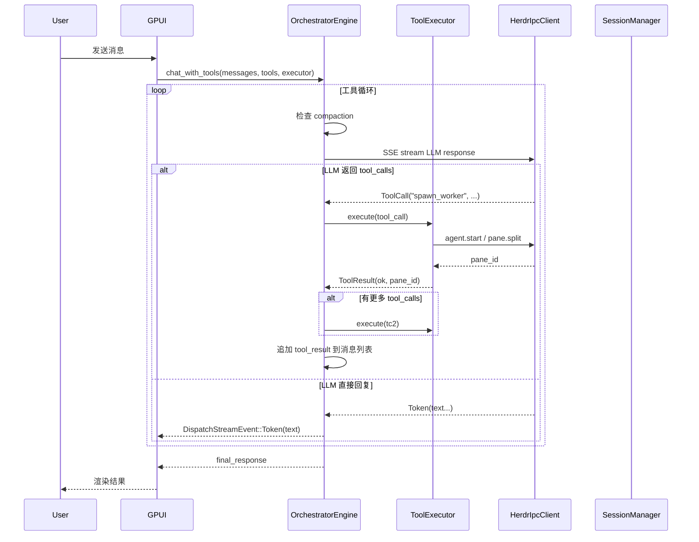

# 工具系统重构 — 设计文档

## 架构概览

### 变更前后对比

```
Before:                              After:
┌─────────────────────┐             ┌──────────────────────┐
│  app.rs              │             │  app.rs               │
│   start_chat_stream  │             │   start_chat_stream   │
│    → chat_and_dispatch│            │    → chat_with_tools  │
│         │            │             │         │             │
│         ▼            │             │         ▼             │
│  engine.rs           │             │  engine.rs            │
│   chat_and_dispatch  │             │   chat_with_tools()   │ ← 主循环
│    ├─ call_llm       │             │    ├─ build_tool_     │
│    ├─ parse_dispatch │             │    │   call_payload   │
│    ├─ exec_agent     │             │    ├─ chat_stream_    │
│    └─ loop           │             │    │   with_tools     │
│                      │             │    ├─ executor.       │
│  engine.rs (dead)    │             │    │   execute(tc)    │
│   chat_with_tools()  │             │    └─ loop            │
│                      │             │                      │
│  tools.rs            │             │  tools.rs             │ ← 6个工具
│   12 tools (dead)    │             │   spawn_worker         │
│   #![allow(dead)]    │             │   send_text            │
│                      │             │   read_output          │
│  mod.rs              │             │   wait_for_output      │
│   exports tools      │             │   list_workers         │
│                      │             │   close_worker         │
│  session.rs          │             │                      │
│   messages/sessions  │             │  file_ops.rs          │ ← 新的内部模块
│                      │             │   read_file (internal)│
│                      │             │   read_directory      │
│  herdr.rs            │             │   search_files        │
│   17 IPC methods     │             │                      │
│   no pane.close      │             │  session.rs           │
│                      │             │   sessions/messages   │
│                      │             │   + memories + FTS5   │
│                      │             │                      │
│                      │             │  herdr.rs             │
│                      │             │   17 + 2 IPC methods  │
│                      │             │   + close_pane        │
│                      │             │   + close_tab         │
└─────────────────────┘             └──────────────────────┘
```

## 模块变更详情

### 1. `src/ai/herdr.rs` — 新增 IPC 方法

添加 `HerdrMethod` 变体：
```rust
#[serde(rename = "pane.close")]
PaneClose(PaneTarget),

#[serde(rename = "tab.close")]
TabClose(TabTarget),
```

添加 `HerdrIpcClient` 方法：
```rust
pub fn close_pane(&mut self, pane_id: &str) -> Result<(), AiError>
pub fn close_tab(&mut self, tab_id: &str) -> Result<(), AiError>
```

`PaneTarget` 已存在（`pane_id: String`），`TabTarget` 已存在。

### 2. `src/ai/tools.rs` — 6 个工具重写

#### 工具注册表

```rust
pub fn builtin_tools() -> Vec<Box<dyn Tool>> {
    vec![
        Box::new(SpawnWorker),
        Box::new(SendText),
        Box::new(ReadOutput),
        Box::new(WaitForOutput),
        Box::new(ListWorkers),
        Box::new(CloseWorker),
    ]
}
```

#### SpawnWorker

```rust
// 参数
{
    "agent": "string (required)",     // CLI 名称
    "instruction": "string (required)", // 任务指令
    "cwd": "string (optional)",        // 工作目录
    "position": {                       // 网格位置（可选）
        "row": "integer (optional)",
        "col": "integer (optional)"
    }
}
```

**内部逻辑**：
1. 如果 herdr 没有活跃的 workspace，创建之（但建议 workspace 由 UI 绑定）
2. 根据 position(row, col) 计算网格布局
   - position 为空 → 默认追加到当前 tab 的末尾
   - 有 position → 推导目标窗格数量 max(row+1, col+1)，用 `pane.split` 补齐
   - 按 row-major 顺序分配窗格
3. 调用 `agent.start` 启动 agent CLI，透传 instruction 作为初始指令
4. 返回 `pane_id` + `terminal_id`

**网格布局算法**：
- 目标网格 = `rows × cols`，其中 rows = position.row+1, cols = position.col+1
- 当前 pane 数 < 目标数 → 创建新 panes
- 目标 pane_index = position.row × cols + position.col
- 返回该 pane 的 ID

#### SendText

```rust
{"pane_id": "string (required)", "text": "string (required)"}
```
通过 `pane.send_text` 发送。如果 worker 支持 `[AGENT_DONE]` 模式，编排器可以结合 read_output 读取回复。

#### ReadOutput

```rust
{"pane_id": "string (required)", "lines": "integer (optional, default=50)"}
```
通过 `pane.read`（source=Recent）读取。

#### WaitForOutput

```rust
{
    "pane_id": "string (required)",
    "pattern": "string (required)",
    "timeout_ms": "integer (optional, default=300000)"
}
```
通过 `pane.wait_for_output` 阻塞等待。返回匹配行内容。

#### ListWorkers

```rust
{}  // 无参数
```
调用 `agent.list` 或 `pane.list`，返回格式化的 worker 列表（名称、pane_id、状态）。

#### CloseWorker

```rust
{"pane_id": "string (required)"}
```
通过 `pane.close` 关闭 pane。错误处理：pane 不存在时返回 OK（幂等）。

#### ToolContext 重构

移除 `herdr_client` 和 `memory` 字段。`ToolExecutor` 内部持有所有依赖：

```rust
pub struct ToolExecutor {
    herdr_client: Arc<Mutex<HerdrIpcClient>>,
    workspace_id: String,
    session_manager: Arc<Mutex<SessionManager>>,
}
```

`Tool::execute` 签名改为接收 `&ToolExecutor` 引用（而非 `ToolContext`）：

```rust
fn execute(&self, executor: &ToolExecutor, args: serde_json::Value) -> ToolResult;
```

**实质变更**：Tool trait 不再依赖松散上下文，而是依赖执行器实例。对 test 的影响——单测改为通过 ToolExecutor 创建实例执行。

### 3. `src/ai/engine.rs` — 核心变更

#### `chat_stream_with_tools()` 修复 payload 构建

**审查发现**：现有 `chat_stream_with_tools()`（engine.rs:769）发送了空 HTTP POST——`_messages` 参数未使用，没有 `.json(&payload)` 调用。

修复方案：将 SSE 流解析逻辑提取为独立函数，`chat_with_tools()` 自行构建 payload 并发送 HTTP 请求：

```rust
// 提取的 SSE 流解析函数（同时处理 OpenAI + Anthropic 格式）
async fn parse_tool_call_sse_stream(
    resp: reqwest::Response,
    on_event: impl Fn(StreamEvent) + Send + 'static,
) -> Result<Vec<(String, serde_json::Value)>, AiError> {
    // ... 从 chat_stream_with_tools 提取的 SSE 迭代逻辑
}
```

#### `chat_with_tools()` 重构

循环结构改为：

```
loop:
  1. Compaction check（保留）
  2. 准备 messages：前置 system prompt（如果第一个不是 system role）
  3. 构建：build_tool_call_payload(messages, tools, model) → payload
  4. 发送 HTTP POST（.json(&payload)）
  5. parse_tool_call_sse_stream(resp, on_event) → tool_calls
  6. tool_calls 为空 → 返回 collected text
  7. 执行 tool_calls → 追加 tool_result 到 loop_messages → 继续循环
```

变更后 `chat_stream_with_tools()` 可删除（其职责被 `parse_tool_call_sse_stream` + `chat_with_tools` 替代）。

#### 删除的函数

- `chat_and_dispatch()` — 整个方法
- `parse_dispatch_directive()` + 相关解析函数（`extract_json_block`, `parse_json_dispatch`, `parse_text_dispatch`, `find_pattern`）
- `classify_agent_error()`
- `call_llm_collect()` — chat_and_dispatch 的辅助函数
- `chat_stream_with_tools()` — 被修复后的 chat_with_tools 替代

#### 删除的函数

- `chat_and_dispatch()`
- `parse_dispatch_directive()`
- `extract_json_block()`
- `parse_json_dispatch()`
- `parse_text_dispatch()`
- `find_pattern()`
- `classify_agent_error()`

#### 保留的类型

- `AgentTask` — execute_agent_task 需要
- `AgentResult` — agent 执行结果
- `DispatchDirective` — 可能被 UI 层使用（渲染 dispatch 卡片）
- `CompactionInfo` — 压缩事件
- `DispatchStreamEvent` — UI 层事件流

**检查点**：检查 app.rs 和 chat 模块是否直接引用了这些保留类型。如果是，保留；如果否，一并删除。

### 4. `src/ai/engine.rs` — 系统提示重构

`build_system_prompt()` 改为只描述工具，删除 dispatch 格式：

```rust
pub fn build_system_prompt(roles_summary: &str, workspace_info: &str) -> String {
    let mut prompt = String::with_capacity(2048);
    prompt.push_str("你是 ZenixAI 编排器...\n\n");

    if has_roles { ... }
    prompt.push_str("## 可用工具\n");
    // 只包含 6 个工具的描述
    prompt.push_str("- spawn_worker: ...\n");
    prompt.push_str("- send_text: ...\n");
    // ...
    
    if has_workspace { ... }
    prompt
}
```

### 5. `src/ai/session.rs` — 记忆表

```sql
CREATE TABLE IF NOT EXISTS memories (
    key TEXT PRIMARY KEY,
    value TEXT NOT NULL,
    session_id TEXT NOT NULL DEFAULT '',
    updated_at TEXT NOT NULL DEFAULT (datetime('now'))
);

CREATE VIRTUAL TABLE IF NOT EXISTS memories_fts USING fts5(
    key, value,
    content=memories,
    content_rowid=key
);
```

`SessionManager` 新增方法：

```rust
pub fn write_memory(&self, key: &str, value: &str, session_id: &str) -> Result<()>;
pub fn read_memory(&self, key: &str) -> Result<Option<String>>;
pub fn search_memory(&self, query: &str, limit: usize) -> Result<Vec<(String, String)>>;
pub fn delete_memory(&self, key: &str) -> Result<()>;
```

注意：FTS5 的 `content_rowid=key` 对 TEXT PRIMARY KEY 不适用——FTS5 要求 integer rowid。需要改为：

```sql
CREATE TABLE IF NOT EXISTS memories (
    id INTEGER PRIMARY KEY AUTOINCREMENT,
    key TEXT NOT NULL UNIQUE,
    value TEXT NOT NULL,
    session_id TEXT NOT NULL DEFAULT '',
    updated_at TEXT NOT NULL DEFAULT (datetime('now'))
);

CREATE VIRTUAL TABLE IF NOT EXISTS memories_fts USING fts5(
    key, value,
    content=memories,
    content_rowid=id
);

-- 同步触发器
CREATE TRIGGER IF NOT EXISTS memories_ai AFTER INSERT ON memories BEGIN
    INSERT INTO memories_fts(rowid, key, value) VALUES (new.id, new.key, new.value);
END;

CREATE TRIGGER IF NOT EXISTS memories_ad AFTER DELETE ON memories BEGIN
    INSERT INTO memories_fts(memories_fts, rowid, key, value) VALUES('delete', old.id, old.key, old.value);
END;

CREATE TRIGGER IF NOT EXISTS memories_au AFTER UPDATE ON memories BEGIN
    INSERT INTO memories_fts(memories_fts, rowid, key, value) VALUES('delete', old.id, old.key, old.value);
    INSERT INTO memories_fts(rowid, key, value) VALUES (new.id, new.key, new.value);
END;
```

### 6. `src/app.rs` — 切换调用

`start_chat_streaming()` 第 3198 行：
```
// Before:
engine.chat_and_dispatch(&messages, &mut herdr_client, &workspace_id, &compactor, ...)

// After:
let executor = ToolExecutor::new(herdr_client, workspace_id.clone(), session_manager);
let tools: Vec<&dyn Tool> = executor.available_tools().iter().map(|t| t.as_ref()).collect();
engine.chat_with_tools(&messages, &tools, &executor, &compactor, ...)
```

注意：`chat_with_tools` 是 async 且接收 `Arc`-wrapped callback。app.rs 中现有的 `DispatchStreamEvent` 处理（handle_dispatch_event）应该兼容。

#### 事件流变更

`chat_with_tools` 发出 `DispatchStreamEvent::ToolCall` 和 `DispatchStreamEvent::ToolResult`——UI 层可能已有对应的渲染。需要确认 `handle_dispatch_event` 中 `ToolCall`/`ToolResult` 的分支是否产生正确的 UI 展示。

### 7. `src/ai/file_ops.rs` — 新内部模块

将 `ReadFile`/`ReadDirectory`/`SearchFiles` 的纯函数逻辑移到新文件，不实现 Tool trait：

```rust
// 保持现有关联函数
pub fn read_file_contents(path: &str) -> Result<String, String>;
pub fn list_directory(path: &str) -> Result<String, String>;
pub fn search_files(path: &str, pattern: &str, max_results: u64) -> Result<String, String>;
```

供内部使用（如代码库上下文收集）。不注册为编排器工具。

## 数据流



## MCP 未来架构（展望）

当前设计确保 6 个工具可以通过两种方式暴露：

```
zenix process
├── OrchestratorEngine (function calling, 进程内)
│   └── ToolExecutor (6 tools)
│
└── MCP Server (后续)
    └── 相同 ToolExecutor (通过 MCP 协议暴露)
        ├── worker_send → send_text
        ├── worker_inbox → read_output
        └── worker_broadcast → ...
```

MCP Server 的设计原则：**不增加新工具，复用现有的 6 个**。编排器的工具就是 MCP 的工具。Worker 通过 MCP 协议调用它们，编排器通过 function calling 调用它们——同一层实现，两个入口。

## 兼容性与迁移

### 向后兼容

- 现有 `chat_simple()` 不变（无需工具的非流式聊天）
- 现有 `chat_simple_with_tools()` 不变
- `DispatchStreamEvent` 的 `ToolCall`/`ToolResult` 变体已在 engine.rs 中定义，UI 侧已有处理分支
- 会话数据库 schema 向前兼容（只添加表，不修改已有表）

### 回滚策略

如果 `chat_with_tools` 在生产环境出现问题：
1. `app.rs` 切回 `chat_and_dispatch` 调用
2. 旧 dispatch 解析函数仍在 git 历史中，可恢复
3. 记忆数据已有 SQLite 备份，回滚不会丢失

### 风险点

1. **ToolExecute 修改 Tool trait 签名**：所有现有工具和测试需适配
2. **chat_with_tools 的参数传递**：tools 列表和 executor 引用的生命周期
3. **UI 兼容性**：`handle_dispatch_event` 中 ToolCall/ToolResult 分支是否已正确渲染
4. **grid 布局的可靠性**：pane.split 的 ratio、tab 切换等边界情况
