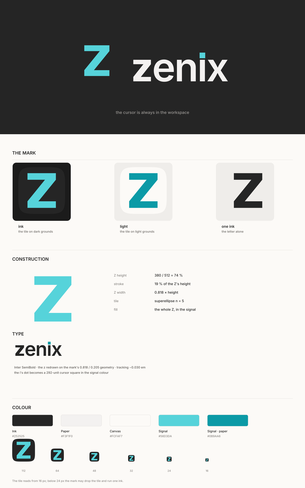

# zenix brand

The mark is a **Z drawn like a pane frame** — two full-width rules joined by one
diagonal — and **the whole letter is lit** in the signal colour. In zenix one pane is
always focused, one agent is always live, one cursor is always on; the letter is that
live thing, not a drawing of it.

The name carries the same thought. It is set in **Inter SemiBold**, the face the app draws
its own chrome in, with the `z` redrawn on the mark's geometry and **the `i`'s dot replaced
by a cursor square** in the same signal colour. The cursor never leaves the name.



## Files

| file | use |
| --- | --- |
| `zenix-icon.svg` | App icon, 512, dark grounds. Source of `res/zenix.png`. |
| `zenix-icon-light.svg` | App icon on light grounds. |
| `zenix-mark.svg` | The Z alone, ink on transparent. One-colour print, stamps, favicons. |
| `zenix-wordmark.svg` | `zenix` lockup, ink + signal dot. The primary logo. |
| `zenix-wordmark-dark.svg` | The same lockup for dark grounds. |
| `zenix-wordmark-mono.svg` | The lockup in one ink. |
| `zenix-logo.svg` | Icon + wordmark row for app listings, About, README heroes. |
| `zenix-logo-dark.svg` | The same row for dark grounds. |
| `metal-study.png` | The metal finishes that were tried and rejected, for the record. |

## Colour

The palette is the application's own: the chrome's ground, its paper, and the terminal's
bright cyan. Nothing new was invented for the logo.

| token | value | use |
| --- | --- | --- |
| Ink | `#252525` | the tile ground; the wordmark on paper |
| Paper | `#F3F1F0` | the Z's edges on a dark ground, the wordmark on ink |
| Canvas | `#FCFAF7` | the light tile ground |
| Signal | `#56D3DA` | the Z on ink, and the cursor dot on ink |
| Signal · paper | `#0B9AA6` | the Z and the dot on paper, where the bright cyan is too light |

One accent, one place: **the letter**. The wordmark stays ink, the tile stays graphite;
nothing else in the identity takes the signal colour.

## Construction

- **Icon, 512 grid.** The tile is a superellipse (`n = 5`) filling the canvas. The Z is
  380 tall (74 % of the tile), 0.818 × its height wide, and its stroke is 19 % of its
  height. Its diagonal is a parallelogram whose perpendicular weight equals the bars', so
  all three strokes read alike. One fill, no gradient: the whole Z is the signal.
- **Wordmark.** Inter SemiBold, x-height 1118 units, tracking −0.030 em. The `z` is the
  mark's letterform at text weight (0.818 width, 0.205 stroke). The `i`'s dot is a
  292-unit square — Inter's own dot size, squared and set in the signal colour.
- **Lockup.** The tile sits left, its bottom on the wordmark's baseline, at 1.56 × the
  x-height; the gap is 0.42 × the x-height. The vertical lockup centres the tile over the
  wordmark.
- **Clear space.** 0.25 × the mark's height on every side. Nothing enters it.
- **Minimum sizes.** The tile reads from 16 px. Below 24 px the tile may be dropped and the
  mark run as `zenix-mark.svg` in one ink.

## Explored: metal and dimension

A lit letter invites a lit object, so the finishes were tried: a bevel at 2, 5 and 8 px, a
face gradient with a top highlight, a machined tile, chrome banding and a floor reflection.
`metal-study.png` is the board. Each one earns its dimension at 512 px and pays for it at
dock size — a bevel's side face turns into a one-pixel halo at 32 px, the extrusion makes
the letter a block, the gradient bands across the diagonal, the machined tile only works on
the dark ground, and the reflection reads as a smudge rather than as polish. The mark keeps
one flat fill: what makes it alive is the colour, not a light.

## Usage

- Do not rotate, shear, outline, emboss or gradient the Z. It is three strokes and one
  fill; any finish on it is someone else's mark (`metal-study.png` shows what each one did).
- Do not two-tone the letter. The lit diagonal was a direction that lost to the whole
  letter being lit; do not bring it back as a highlight.
- Do not set the name in another face or swap the `z` for a stock one; the two z's are the
  same drawing at two weights.
- On a busy photograph, use the tile (it gives the mark its own ground) or the one-ink mark.
- The mark is never a button icon inside the app; the app's own command icons stay in the
  component library's set.

## Regenerate

The SVGs are the source; PNGs are rendered from them.

```bash
# app icon (512, RGBA) — the .deb ships this file
rsvg-convert -w 512 -h 512 docs/brand/zenix-icon.svg -o res/zenix.png

# any other size
rsvg-convert -w 256 -h 256 docs/brand/zenix-icon.svg -o /tmp/zenix-256.png
```
